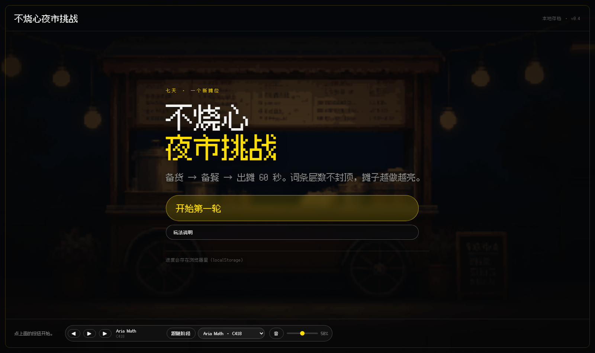
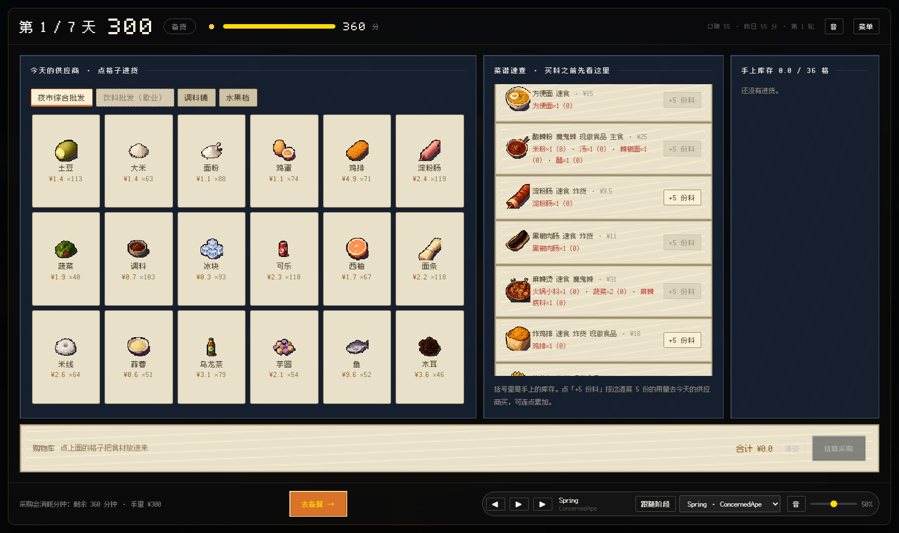
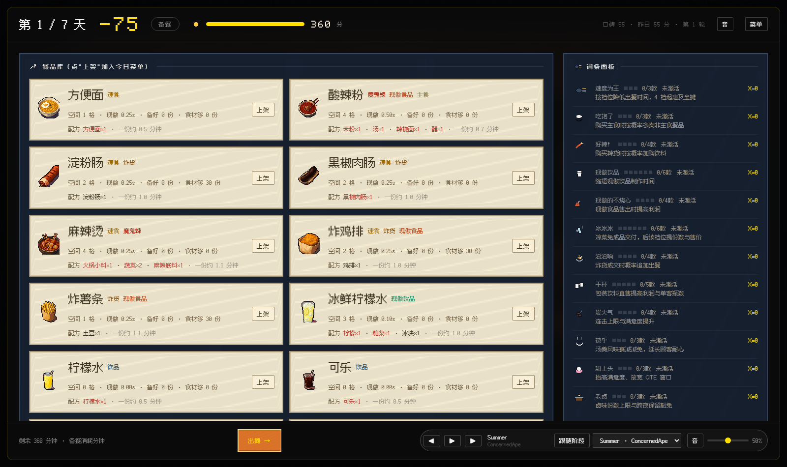
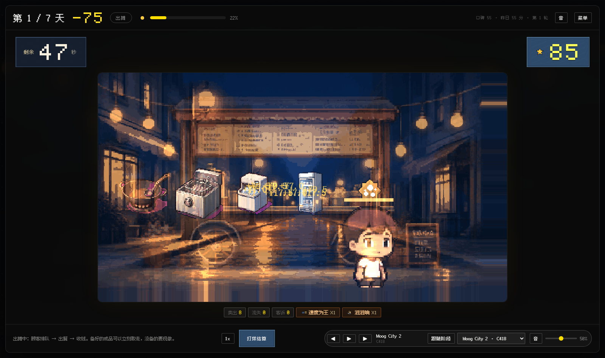

# 不烧心夜市挑战 · Night Market Challenge

> 七天，一个摊位，一条越点越亮的街。

一个跑在浏览器里的**增量经营 × 夜市摆摊**游戏原型：备货 → 备餐 → 出摊 60 秒实时 → 结算 → 加成，七天一局，词条层数永久累积、不封顶。



---

## 这是什么

你是夜市摆摊的摊主。每天 20:00-24:00 的四小时营业，被压缩成**一段 60 秒的实时演出**：顾客走过来、点单、你的锅和炸锅排队出餐、成交飘字、层数往上跳。前面两段（备货、备餐）做什么决定，第三段全部兑现。

核心循环不是"卖得多"，而是**构筑**：

- 每道菜带 1~3 个**属性**（速食 / 主食 / 魔鬼辣 / 炸货 / 现做食品 / 现做饮品 / 饮品 / 凉菜 / 烤物 / 汤羹 / 甜点 / 卤味，共 12 个）
- **同属性的菜上架够款数**才会点亮对应**词条**（速度 3 款、辣 4 款、饮品 5 款、冰饮 6 款…）
- 卖出成交会养词条的**层数**，层数决定词条档位；层数**永久累积、跨日跨轮都在**
- 两条词条同时达标会触发**共鸣**，8 组，各 3 档

于是每天的题是：台面只有这么大，你要把哪条线堆到哪个档位？

| 备货 | 备餐 |
|---|---|
|  |  |



---

## 跑起来

纯前端，**零依赖、零构建**（原生 ES Module + Canvas 2D + DOM）。需要一个静态服务器，直接双击 `index.html` 不行（模块 + fetch 会被 CORS 拦）：

```bash
git clone https://github.com/FubukiQAQ/night-marketing-challege.git
cd night-marketing-challege
python -m http.server 8777
# 打开 http://127.0.0.1:8777/
```

任何静态服务器都行（`npx serve`、`nginx`、VS Code Live Server 均可）。

---

## 玩法速览

1. **备货 8:00-14:00** — 今天随机开 3~5 家供应商（1 家综合批发 + 品类档）。菜谱速查里能看每道菜的配方和当前库存，点「+5 份料」直接按 5 份的量去今天的市场补齐。采购吃分钟也吃现金，储存格有限。
2. **备餐 14:00-20:00** — 上架/下架、定价、按份预加工。台面格（含厨具占地）是硬约束；右边词条面板实时显示每个属性的上架款数与下一档门槛。
3. **出摊 20:00-24:00** — 60 秒、12000 tick。预加工成成品的立刻取走，没备的要现做（占厨具、要时间）。顾客有耐心，等太久会走。
4. **结算** — 营业额达成率 + 满意度 − 客诉 − 缺货流失 → 评分 → 次日客流 + 今日经验 → 三选一加成。
5. **局外** — 七天后结算经验，点技能（效率 / 容量 / 风味），带着层数开下一轮。

存档在本地浏览器（`localStorage`），一轮进度和跨轮 meta 分开存：开新一轮会带走层数与技能，只有「清空存档」才真删。

---

## 内容规模

| 项 | 数量 |
|---|---|
| 属性（标签） | 12 |
| 词条 | 12 条 × 6 档显式阶梯（第 7 档起公式延伸，**不封顶**） |
| 共鸣 | 8 组 × 3 档 |
| 层数来源规则 | 18 类（销量 / 概率 / 营业额 / 阶段钩子 / 首售 / 连击 / QTE / 优档成品 / 事件 / 共鸣） |
| 餐品 | 82 |
| 食材 | 126（含 5 级加工链：原料 → 食材 → 生半成品 → 熟半成品 → 成品） |
| 厨具 | 13（锅 / 炸锅 / 烤炉 / 铁板 / 蒸笼 / 汤桶 / 卤锅 / 制冰机 / 榨汁机 / 豆浆机 / 搅拌机 / 电饭煲 / 冰柜） |

---

## 技术

- **渲染**：出摊场景 = Canvas 2D **960×540**（HD 素材原生分辨率），整数倍放大 + `image-rendering: pixelated`；管理与结算界面 = DOM。
- **模拟**：`src/core.js` 是**纯逻辑、零 DOM 依赖**的固定步长模拟（200 tick/s × 60 s = 12000 tick），所以能在 Node 里无头跑。
- **数据**：`配表/不烧心夜市-配表.xlsx`（13 个 sheet）是唯一真源，`tools/build_tables.py` 生成表 + 校验报告，`tools/export_game_data.py` 导出 `src/data/*.json`。
- **美术**：`assets/art_hd/` 源图 → `tools/pack_atlas_hd.py` 打包成 6 张图集（426 帧），场景大图保持独立文件。
- **字体**：缝合像素字体 Fusion Pixel 12px（OFL，见下）。
- **音频**：`src/audio.js` 双 audio 元素交叉淡入；曲目表 `src/data/tracks.json`，支持跟随阶段或手动锁曲。

```
index.html / styles.css     入口与设计系统
src/core.js                 状态机、词条/阶梯/共鸣、出摊 tick 模拟、结算
src/save.js                 本地存档（run / meta 分离 + 版本迁移）
src/sprites.js              图集加载与绘制
src/render.js               出摊场景 Canvas 渲染
src/ui.js                   所有界面
src/main.js                 引导、主菜单、阶段路由、出摊循环、事件委托
src/data/*.json             游戏数据（工具链生成，勿手改）
配表/                        数值与内容表（改这里再重新生成）
assets/                     美术素材 + packed/（重新打包的图集）
docs/                       策划案、美术需求文档、截图
tools/                      数据流水线 + 无头验证脚本
```

### 自测

```bash
node tools/headless_run.mjs     # 无头模拟一个玩家跑完 7 天，打印每天营收/评分/层数
node tools/check_assets.mjs     # 校验所有贴图引用都能在图集里解析
python tools/check_text.py      # 扫一遍文本文件有没有编码乱码
```

浏览器里还有几个调试入口（写进 `document.title`，方便自动化）：

| URL | 作用 |
|---|---|
| `?dev=play` | 端到端：用真实 DOM 点击走完 7 天 |
| `?dev=menuflow` | 主菜单：开局 → 存档 → 继续 → 清档 |
| `?dev=cart` | 备货购物车：加购 → 合计 → 结算 → 清空 → 切页签 |
| `?dev=qte` | 特殊来客 QTE：时机成功 / 三选一对 / 三选一错 / 超时判负 |
| `?dev=qte2` / `?dev=qte2pick` | 定场在「特殊顾客在队 + QTE 待处理」，截图用 |
| `?page=archive` | 直接打开街坊名录 |
| `?dev=tutorial` | 新手教程端到端：9 步全部走一遍并校验 |
| `?dev=signature` | 招牌菜：定招牌 / 冲突拦截 / 占位 / 加速 / 不可更换 / 溢价 |
| `?dev=regulars` | 熟客：升级 / 同日限一次 / 封顶 / 出现权重 / 偏爱 / 掉级 / 清零 |
| `?dev=regsview` | 造几个熟客，看备餐侧栏 |
| `?dev=qte2mash` / `?dev=qte2math` | 定场在连点 / 算账 QTE，截图用 |
| `?dev=qte2rhythm` | 定场在节奏 QTE，截图用 |
| `?dev=sigview` | 定好招牌后停在备餐，截图用 |
| `?dev=wx&w=rain` | 定场在指定天气 + 同行强度（`rain` / `hot` / `cold` / `clear`） |
| `?dev=stock` / `?dev=prep` / `?dev=sell2` / `?dev=settle` / `?dev=meta` | 直接跳到对应阶段 |
| `?dev=prepLayers` | 造出层数 + 已上架菜单，看词条树激活态 |
| `?dev=width` | 输出 `scrollWidth / clientWidth` 与越界元素，查响应式溢出 |
| `?dev=touch` | 触控审计：44px 达标率、横向溢出、tap / touch-action 实际计算值 |
| `?dev=touch&phase=prep` | 按阶段审计（`stock` / `prep` / `sell` / `settle`） |
| `?dev=probe&phase=sell` | 输出各层容器实测尺寸，调版面用 |

---

## 版本

| tag | 内容 |
|---|---|
| `v0.1` | 可玩原型：7 天一周目、词条层数与共鸣、配表流水线 |
| `v0.2` | 视觉重做：点阵字体 + 字号放大、ignoredone 风格设计系统 |
| `v0.3` | 画框撑满视口；备货界面菜谱速查 + 一键买料 |
| `v0.3.1` | 出摊计时/收益改大字、买料累加、重渲染保留滚动位置 |
| `v0.4` | 主菜单 + 本地存档（run/meta 分离、迁移、清档确认）、图标放大 |
| `v0.5` | **HD 精细像素材质全套替换**（960×540 五层视差场景、82 餐品、126 食材、13 厨具、8 类顾客×5 态）+ 分场景 BGM |
| `v0.5.1` | 人物放大 3 倍并重排版面；BGM 改为可选曲目的播放器（跟随阶段 / 手动锁定 / 音量） |
| `v0.8` | UI/美术优化：canvas 像素精确缩放、位图数字、9slice 像素面板、米纸调色板、标签四态 |
| `v0.9` | 信息架构与响应式：备货格子货架 + 购物车、词条树 + 筛选、出摊 HUD 徽章、1920/1440/720 三档 + 移动端 |
| `v1.0` | 叙事内容层：开场白、每日一句、结算评语、烟火气、三种结局（对齐主题「市井烟火·百味人间」） |
| `v1.1` | 特殊来客 + QTE（时机 / 三选一，5 类立绘）、街坊名录 |
| `v1.2` | 新手教程：9 步试营业引导、金色高亮、起步料、可跳过可重看 |
| `v1.3` | 触屏优化：44px 触控目标、:active 反馈、货架滑动切页签、QTE 贴底可点、安全区 |
| `v1.4` | 天气 / 随机事件 / 招牌菜 / 同行竞争：每天不再一样 |
| `v1.5` | QTE 补齐四类（+连点催单 / 算账找零）、熟客系统 |
| `v1.6` | 节奏颠勺 QTE（第五类）、完整版 / 匿名版提交包 |

---

## v0.9 信息架构与响应式

### 备货页改格子货架

供应商从列表行改成**页签 + 格子货架 + 底部购物车**：一屏可见 SKU 从 6 个提到 18 个。点格子加购、底部统一结算，不用再为每样食材点三个数量按钮。库存挪到货架页下方，不再挤在菜谱下面。

### 备餐页词条改树状

从 12 行平铺改成三层树：**标签（你上架什么）→ 词条（你得到什么）→ 档位进度**，并直接列出该标签下已上架的菜。顶部加了「全部 / 已激活 / 差一款」筛选。

### 出摊 HUD 徽章化

倒计时与收益改成像素徽章（时间 ≤10 秒泛红），底部统计做成徽章条。

### 响应式（比赛要求 1920 / 1440 / 720）

| 断点 | 处理 |
|---|---|
| ≥1760 | 放宽留白、字号上调、格子加大 |
| 1600 | 收紧间距 |
| 1360 | 库存下移成一条 |
| 1024 | 单列堆叠、顶栏换行、隐藏次要信息 |
| 768 | 移动端：全屏、格子可滚、出摊 canvas 撑满、底栏换行 |
| 480 | 防横向溢出：徽章与统计条再压一档 |

---

## v0.8 UI/美术优化

不加新玩法，全部是"让已有的东西看得见"。

| 改动 | 说明 |
|---|---|
| **修 canvas 拉伸** | `object-fit: fill` 与 `aspect-ratio` 冲突导致画面被横向压扁（实测 1.65 而非 1.78）。改成 JS 按 0.25 整数倍精确算显示尺寸 |
| **位图数字** | 接入 `ui_digits_*`；图集实际是 **16 格**、格宽 `w/16`（不是 14 格 / `size`），字形顺序 `0-9 + - ¥ : / %` |
| **9slice 像素面板** | 面板/按钮/卡片换成 64×64 九宫格（`assets/ui9/`），前景与后景的像素语言终于一致 |
| **米纸调色板** | 浅纸面（`#E8E0C8`）上文字转深棕，修掉"白字看不清" |
| **标签四态** | 词条图标按状态取 `normal / highlight / fragile / grayed` |

---

## v1.0 叙事内容层

对应比赛主题**「市井烟火 · 百味人间」**，补上文案层（此前游戏只有数值，没有一句人话）。

| 位置 | 内容 |
|---|---|
| 主菜单 | 四句开场白，交代"借来一辆旧推车，七天撑起半条街的烟火气" |
| 备餐页 | 每天一句情景开场（开张 / 回头客 / 讲究 / 半程 / 老规矩 / 人最多的一晚 / 最后一晚） |
| 结算页 | 按评分档位给的叙事评语（锅气冲天 / 生意不错 / 稳当 / 有点凉 / 几乎没开张） |
| 结算页 | 「烟火气」——已点亮词条的氛围句，把机制翻译成人话 |
| 局外 | 三种结局（这条街记住你了 / 撑下来了 / 来年再来） |
| 数据 | 8 类顾客的小传（学生 / 夜班工人 / 外卖骑手 / 情侣 / 老街坊 / 喝多了的 / 小孩 / 跑腿的） |

所有文案集中在 `src/data/story.json`，不写死数值，缺失时整段自动隐藏，不会报错。

---

## v1.1 特殊来客与街坊名录

### 特殊来客 + QTE

出摊时小概率出现 5 类特殊顾客（`chr_special_*` 的 160×160 立绘，之前一直闲置）：

| 来客 | 要什么 | QTE | 答对 |
|---|---|---|---|
| 探店博主 | 凉菜 / 甜点 / 现做饮品 | 三选一 | 营业额 ×1.6 + 口碑 +3 |
| 美食评论家 | 卤味 / 汤羹 / 烤物 | 时机 | ×2.2 + 口碑 +4 |
| 大胃王 | 任意 | 三选一 | ×2.6 + 口碑 +1 |
| 老饕 | 现做食品 / 烤物 / 卤味 | 时机 | ×1.9 + 口碑 +3 |
| 金主代跑 | 任意 | 时机 | ×3.0 + 口碑 +2 |

成交后弹出 QTE：
- **时机**：指针从 0 扫到 1，进绿区（44%~60%）时按「上菜！」
- **三选一**：三个应对选项，选对加分
- 答错扣口碑、计一次客诉；**超时只扣一半口碑、不计客诉**（避免玩家没注意到就被重罚）

五种来客的情绪立绘（normal / happy / unhappy）按结果切换。

### 街坊名录

主菜单新增「街坊名录」页：8 类常客的小传 + 一句口头禅，外加 5 类特殊来客的说明。

---

## v1.2 新手教程

第一次进游戏会走一遍「试营业」引导，9 步，跟着做就会玩。

| 步 | 阶段 | 教什么 |
|---|---|---|
| ① | 备货 | 点格子把食材放进购物车 |
| ② | 备货 | 结算采购（吃现金也吃分钟） |
| ③ | 备货 | 去备餐 |
| ④ | 备餐 | 上架一道菜（同属性够款数会点亮词条） |
| ⑤ | 备餐 | 备几份成品 |
| ⑥ | 备餐 | 出摊 |
| ⑦ | 出摊 | 等出餐、看倒计时 |
| ⑧ | 出摊 | 特殊来客 QTE |
| ⑨ | 结算 | 选一个加成 |

实现要点：

- 教程卡固定在左下角，**不阻塞任何操作**；目标元素有金色呼吸描边，并自动滚进可视区
- 进度存在 `G.s.tut`，跟着存档走；随时可「跳过引导」，菜单里也能「重看新手引导」
- **试营业会给一套起步料**（按教学菜配方 ×10），保证「上架 → 备份 → 出摊」这条链一定能跑通——否则玩家只买一样东西就会在出摊时无事发生
- 教学菜是**动态挑的**：在「有厨具 + 配方 ≤2 种料 + 占位 ≤2 格」的菜里按价格取最高，所以每轮都不会卡在缺厨具的菜上

---

## v1.3 触屏优化

手机上不再是「能看」而是「能玩」。

### 基础触屏行为

| 项 | 处理 |
|---|---|
| 300ms 点击延迟 | `touch-action: manipulation` 全站去掉 |
| 系统蓝色高亮 | `-webkit-tap-highlight-color: transparent`，改用自绘按下反馈 |
| 长按弹菜单 / 选中文字 | `user-select: none` + `-webkit-touch-callout: none`（输入框除外） |
| 下拉刷新 / 橡皮筋 | `overscroll-behavior: none` |
| 刘海屏 | `env(safe-area-inset-*)` 四边留白 |
| 地址栏高度 | `100dvh` |

### 触控目标

所有可点元素 **≥44×44 CSS px**（比赛要求）。`?dev=touch` 会自动审计并报出不足 44px 的元素，当前四个阶段实测 `under44=0`。

### 用 `:active` 替代 `:hover`

触屏上 `:hover` 会「粘住」——点完一直亮着。所以在 `@media (hover: none)` 里先清掉所有 hover 效果，再补 `:active` 的按下反馈（缩放 + 亮度）。

### 手势

- **货架左右滑**切换供应商页签（位移 >56px 且横向为主才判定，不会和点格子打架）
- **QTE 时间轴整条可点**，不用非得点下面那个按钮——手指会挡住按钮
- 出摊 canvas 上禁止滚动手势

### 移动端布局修正

- 顶栏改单行不挤压（原来 flex 会把现金压到 17px 宽）
- QTE 面板固定贴底，QTE 出现时自动隐藏教练卡
- 底栏按钮等分整行、高 44px，拇指够得到

---

## v1.4 每天不再一样：天气 / 随机事件 / 招牌菜 / 同行

之前七天玩的是同一道题，只有客流数字在涨。这一版把「今天和昨天有什么不同」补上了。

### 天气（`src/data/weather.json`）

第 1 天恒为晴（新手不该第一天吃天气惩罚），之后每天随机：

| 天气 | 客流 | 单价 | 需求变化 |
|---|---|---|---|
| 晴 | — | — | — |
| 雨 | −18% | +18% | 汤羹 +55%、现做食品 +20%；烤物 −25%、凉菜 −30% |
| 闷热 | +6% | — | 现做饮品 +60%、饮品 +45%、凉菜 +35%；汤羹 −38% |
| 降温 | −5% | +5% | 汤羹 +45%、卤味 +30%；凉菜 −40%、现做饮品 −28% |

出摊画面会真的下雨（雨丝 + 地面湿反光）、闷热泛暖、降温泛冷。

### 随机事件（`src/data/events.json`，8 个）

备货阶段（立刻生效）：

| 事件 | 效果 |
|---|---|
| 供应商停业 | 随机关 1 家（综合批发是保底渠道，不会被关） |
| 涨价潮 | 某家全线 +30% |
| 清仓甩卖 | 某家 −38%、库存 ×2 |
| 邻居送菜 | 白送 15 份随机食材 |
| 冷库故障 | 损失 25% 库存 |

出摊阶段（按排期触发，一局 ≤2 个）：

| 事件 | 效果 |
|---|---|
| 团购订单 | 一次塞入 4 个同属性顾客 |
| 夜市活动 | 当场客流 ×1.35 |
| 厨具故障 | 随机一台设备工位清零，到打烊为止 |

约束按 `docs/06` 执行：同组互斥、有冷却与单局上限、**综合批发永不关闭**（保证不会出现无货可买的死局）。出摊事件用**预排期**而不是每 tick 概率——概率会出现「一晚 4 个」的失控，排期才能控制节奏。

### 招牌菜

开局（或任意备餐日）可以把一道菜定为**招牌**，定下这一轮不可更换：

- 售价 **+40%**、备餐时间 **−20%**
- 额外占 **3 格**台面
- **同属性的其他菜全部下架，且无法再上架**

这一下把「我要堆哪条线」从一句规划变成了一次下注：选了招牌辣菜，魔鬼辣这条线就锁死了。

### 同行竞争（`src/data/rival.json`）

街尾有一家摊子，强度随**天数**和**你昨天的评分**成长——你越强它越努力。它会盯住你上架最集中的那个属性，在那条线上抢客；你堆得越多，它抢得越狠。

出摊画面右后方能看到它的棚子和灯，灯越亮说明它越拼。

---

## v1.5 QTE 补齐四类 + 熟客

### QTE 四类（对应 `docs/06` §6.2）

| 类 | 顾客 | 玩法 | 成功 |
|---|---|---|---|
| 时机 | 老饕 / 金主代跑 / 评论家 | 指针扫过绿区时点一下 | 订单溢价 |
| 三选一 | 探店博主 | 3 秒内选出最得体的应对 | 口碑 +3 |
| **连点** | 大胃王 | 3 秒内连点 12 次 | 单笔 ×2.6 |
| **算账** | 美食评论家 | 他递来 ¥50，选出正确找零 | 口碑 +4 |

连点按钮做到 56px 高（手机 62px），整条时间轴也能点。算账是 2×2 大按钮，选项里只有一个是对的。

### 熟客

| 项 | 规则 |
|---|---|
| 升级 | 该顾客这次满意度 ≥4.3，**50% 概率**升一级，每天最多升一次 |
| 上限 | Lv.3 |
| 效果 | 出现权重 ×1.0 / ×1.35 / ×1.8 / ×2.3；耐心 +0~50%；预算 +0~18% |
| 偏爱 | 有固定爱吃的属性，等级越高越常点（Lv.3 时 84%） |
| 掉级 | 连续 **2 天**没上他爱吃的菜 → 掉一级 + 口碑 −1，并在次日提示 |
| 表现 | 出摊时头顶 `★` 数量 = 等级；备餐侧栏顶部列出「爱吃的菜」上没上架 |

设计意图：它奖励**菜单稳定**——和招牌菜是同一套价值取向。你固定做几条线，熟客就越养越多；天天换菜，熟客会走。

---

## v1.6 节奏颠勺 + 提交包

### 节奏颠勺（第五类 QTE）

至此 `docs/06` §6.2 的四类全部落地，另加这一类共 **5 种**：

| 类 | 顾客 | 玩法 | 结果 |
|---|---|---|---|
| 时机 | 金主代跑 | 指针扫过绿区时点一下 | 订单溢价 |
| 三选一 | 探店博主 | 3 秒内选出最得体的应对 | 口碑 +3 |
| 连点 | 大胃王 | 3 秒内连点 12 次 | 单笔 ×2.6 |
| 算账 | 美食评论家 | 他递来 ¥50，选出正确找零 | 口碑 +4 |
| **节奏** | 炸货老饕 | 3 个拍点，落点准不准 | 3/3 满额、2/3 减半、≤1/3 判负 |

节奏类的判定是「离拍点 < 8.5% 进度」算命中，点早了记一次失误但不推进拍点（还有机会）。漏掉的拍点在 `tick` 里自动判负——所以完全不动手会稳定拿到 0/3。

### 提交包

`tools/build_submission.py` 生成两个包：

| 包 | 内容 |
|---|---|
| `dist/不烧心夜市挑战-完整版.zip` | git 跟踪的全部 1366 个文件 |
| `dist/不烧心夜市挑战-匿名版.zip` | 同上，`FubukiQAQ` → `dev`，README 的 clone 行换成中性说明 |

两个包都**不含商业 BGM**（`sound/*.mp3` 本来就在 `.gitignore` 里，版权见 `sound/README.md`），也自动排除了 `_raw/` 美术中间产物（127 MB，可 `RUN_ART.bat` 重跑）。

打包后实测：解压 → `python -m http.server` → `?dev=play` 跑完 7 天、`?dev=qte` 五类全过、`check_assets` 426 帧全解析。无 BGM 状态下游戏正常运行（曲目加载失败会静默跳过）。

---

## 已知限制 / 下一步

- 随机事件已实现 8 个（备货 5 / 出摊 3）；设计稿里的天气细分与更多事件还没做
- QTE 五类已齐（时机 / 三选一 / 连点 / 算账 / 节奏）
- 供应商只有现场采购，还没有「在线订货 T+1」通道
- 成品跨日保留、冰柜冷藏加成、外卖渠道未做
- 数值是 v0 骨架，靠无头模拟粗调过一轮，远未平衡
- 触屏做了 44px 触控、手势与安全区，但只在无头浏览器里审计过，**真机手感未验证**
- BGM 曲目为商业作品，未随仓库分发（见 `sound/README.md`）

---

## 素材与授权

- **字体**：[缝合像素字体 Fusion Pixel Font](https://github.com/TakWolf/fusion-pixel-font)（作者 TakWolf，版本 2026.10.25，简体中文子集），**SIL Open Font License 1.1**。再分发时请附带上游 OFL 全文。
- **美术素材**：`assets/art_hd/` 为 AI 生成的 HD 精细像素素材（生成脚本与提示词见 `tools/artgen*.py`、`tools/art_prompts.py`）。
- **BGM**：曲目版权归原作者（C418 / ConcernedApe），**未随仓库分发**，详见 `sound/README.md`。
- **数值与文案**：本项目原创。

## 许可

代码以 MIT 许可发布；字体遵循其自身 OFL 授权；美术素材版权归作者所有。
