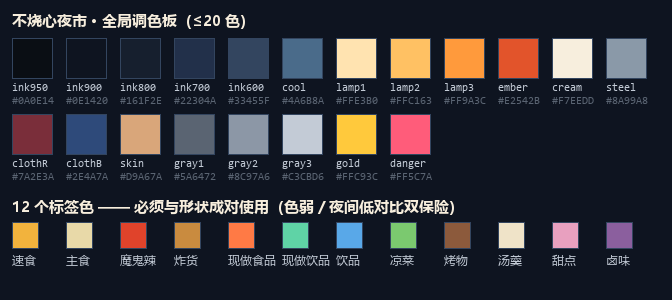
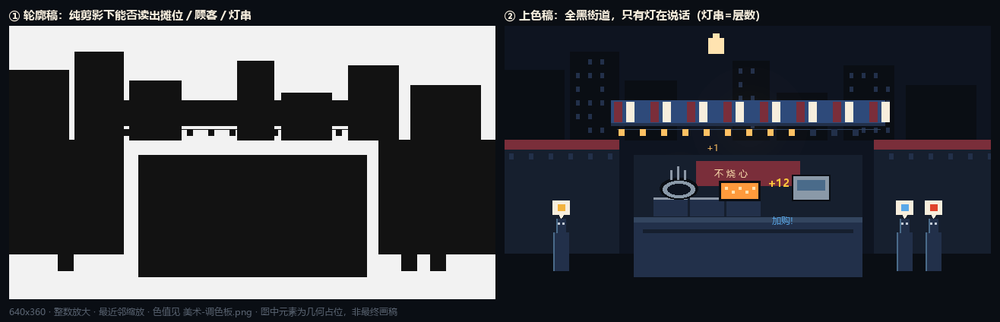

# 不烧心夜市挑战 · 美术需求文档

> 版本 v1.0 ｜ 2026-11-04 ｜ 风格：**HD 感像素（中密度）**
> 本文件**自包含**：美术只看这一份就能开工，不需要读策划案。
> 游戏类型：增量 / 夜市摆摊经营 ｜ 平台：**Web（浏览器，兼容移动端横屏）**
> 技术渲染：PixiJS（WebGL 2D）｜ 场景画在 canvas，UI 层在 DOM

---

## 一、风格定位

### 1.1 一句话

> **一条全黑的街道，只有灯在说话。** 玩家摊位上方那排灯串，就是他的层数。

### 1.2 为什么是像素

| 理由 | 说明 |
|---|---|
| 内容量 | 82 道餐品、126 种食材、13 件厨具。像素图标是唯一能画完的量级 |
| 游戏类型 | 增量游戏每秒钟刷十几次数字，需要"机械、脆、积木感"的视觉。像素天生如此 |
| 夜间场景 | 像素的"暗部偏冷、亮部偏暖"两段式调色 + 加法光斑，比手绘渐变更干净也更快 |
| Web 性能 | 小图集、最近邻放大，200 tick/s 的实时模拟下几乎零成本 |

### 1.3 密度决策（重要，不要往上加）

| 档位 | 基准分辨率 | 判断 |
|---|---|---|
| 低密度 | 320×180 / 480×270 | 太糊，82 道菜糊成一团 |
| **中密度（采用）** | **640×360**，整数放大 ×2 / ×3 | 成本可控、小尺寸可辨 |
| 高密度（真 HD） | 1280×720 原生像素 | **不采用。** 成本接近手绘的 3~5 倍，而 60 秒内的辨识度反而更低 |

> "HD 感"只体现在**光照、特效、动效**上（加法光斑、粒子、数字缓动），像素本体保持中密度。

### 1.4 三条铁律

1. **场景全暗，光即信息。** 没被光源照到的地方就是黑的，不要为了"看得见"而提亮。玩家在 60 秒里只需要看清"哪里亮起来了"。
2. **轮廓优先于细节。** 任何 sprite 缩到 24px 仍要能一眼认出。认不出就砍细节，不要加细节。
3. **一切信息都有形与色两套编码。** 12 个标签不能只靠颜色区分（色弱 + 夜间低对比会失效），必须各自配一个形状。

### 1.5 视觉参考 / 反例

**参考方向**：香港庙街、日本屋台的夜间摄影（光比照抄，不要照抄构图）；《潜水员戴夫》的餐品质感与夜间霓虹；《Eastward》的暗部层次；《月光石岛》的柔和像素密度；《星露谷物语的风格》

**明确禁止**：
- ❌ 赛博朋克紫粉霓虹（会把暖光层次全吃掉，且廉价）
- ❌ 4 色 GB 调色（中式小吃需要中间调才认得出）
- ❌ 给 sprite 加模糊、外发光模糊、抗锯齿缩放（像素会"发虚"）
- ❌ 把中文正文做成像素字（12px 以下中文不可读，见 §4.6）
- ❌ 真实照片纹理贴图

---

## 二、技术规范（必须遵守，验收会查）

### 2.1 画布与像素网格

| 项 | 规定 |
|---|---|
| 基准分辨率 | **640×360**（16:9） |
| 放大 | 仅整数倍：×2（1280×720）、×3（1920×1080）；非整数窗口用 letterbox 黑边 |
| 像素网格 | 所有 sprite 必须对齐 1px 网格，**禁止半像素、禁止亚像素定位** |
| 基础单位 | 1 逻辑格 = **16×16 px**；摊车台面 1 格 = 3×3 = **48×48 px** |
| 缩放 | 最近邻（nearest），图集内所有图必须是 1x 原始尺寸，不要预先放大 2 倍 |

### 2.2 Sprite 尺寸档位（只允许这几档）

| 档位 | 用途 |
|---|---|
| 16×16 | 小料、调料点、状态小图标、粒子 |
| 24×24 | **餐品图标（标准）**、标签 / 词条图标 |
| 32×32 | 顾客（半身或小全身）、小型道具 |
| 48×48 | 厨具、食材箱、桌面设备 |
| 96×96 / 192×192 | 摊车主模块、大件（炸全鸡托盘、大锅） |

### 2.3 全局调色板（≤20 色，超出需报备）

| 名称 | 色值 | 用途 |
|---|---|---|
| ink-950 | `#0A0E14` | 最暗，剪影、屏幕底 |
| ink-900 | `#0E1420` | 夜景背景 |
| ink-800 | `#161F2E` | 暗块、面板底 |
| ink-700 | `#22304A` | 暗部中间调 |
| ink-600 | `#33455F` | 暗部高光边 |
| night-cool | `#4A6B8A` | 月光 / 冷反光 |
| lamp-1 | `#FFE3B0` | 灯芯、高光 |
| lamp-2 | `#FFC163` | 灯光主色、灯串 |
| lamp-3 | `#FF9A3C` | 火光橙、炸锅 |
| ember | `#E2542B` | 炭火、辣椒油 |
| cream | `#F7EEDD` | 瓷碗、正文文本 |
| steel | `#8A99A8` | 金属、锅具 |
| cloth-red | `#7A2E3A` | 暗红雨棚 / 布 |
| cloth-blue | `#2E4A7A` | 红白蓝雨棚的蓝 |
| skin | `#D9A67A` | 肤色（仅特殊顾客） |
| gray-1 | `#5A6472` | 中性暗 |
| gray-2 | `#8C97A6` | 中性中 |
| gray-3 | `#C3CBD6` | 中性亮 |
| gold | `#FFC93C` | **一切金钱与增长** |
| danger | `#FF5C7A` | 差评、流失、涨价警告 |

### 2.4 12 个标签色 + 形状（成对使用，缺一不可）

| 标签 | 颜色 | 形状 | 图标语义 |
|---|---|---|---|
| 速食 fast | `#F2B33D` | **方形** | 冒热气的碗 |
| 主食 staple | `#E8D9A8` | **圆形** | 饭团 / 满碗饭 |
| 魔鬼辣 spicy | `#E0432B` | **三角** | 辣椒 |
| 炸货 fried | `#C98B3F` | **尖角星** | 油花 / 波浪边 |
| 现做食品 madedish | `#FF7A45` | **半月** | 锅铲 |
| 现做饮品 madedrink | `#5FD3A6` | **水滴** | 带吸管的杯 |
| 饮品 drink | `#59A8E8` | **瓶形** | 易拉罐 / 瓶 |
| 凉菜 cold | `#7BC96F` | **菱形** | 雪花 / 叶子 |
| 烤物 grilled | `#8C5A3C` | **条纹** | 签子串 |
| 汤羹 soup | `#EFE3C8` | **碗形** | 汤碗 + 蒸汽 |
| 甜点 dessert | `#E8A0BF` | **圆点组** | 冰淇淋 / 甜品杯 |
| 卤味 braised | `#8B5F9E` | **方块叠** | 卤锅 / 酱色块 |

### 2.5 动画规范

| 项 | 规定 |
|---|---|
| 手绘帧率 | 8 fps（常规）、12 fps（关键动作，如出餐、QTE） |
| 位移 / 缩放 / 透明度 | 用引擎 tween 插值，不要逐帧画 |
| **旋转** | 像素 sprite **禁止任意角旋转**，仅允许 90° 倍数 |
| **缩放** | 禁止非整数缩放（会出现像素大小不一）；需要"变大"时用整数倍或换一张大图 |
| 循环动画 | 必须首尾无缝（蒸汽、灯串闪烁、油花） |
| 单 sprite 帧数上限 | 常规 ≤6 帧（2 帧足够表达闪烁/冒气就不要画 6 帧） |

### 2.6 光照

- 所有光源用**加法叠加（additive）的光斑 sprite**，预渲染，不要用引擎模糊。
- 光斑必须是"像素化渐变"：2~3 阶色带 + dither，禁止平滑径向渐变（会和像素风打架）。
- 单屏同时可见光源 ≤6 个（灯串算 1 个、灶火、炸锅、烤箱、招牌、月光）。
- 需要"整条街点亮"时，不是加灯，而是**换一张更亮的背景层**（见 §5.1）。

### 2.7 图集与交付格式

| 项 | 规定 |
|---|---|
| 图集 | 单页 ≤ 2048×2048；建议按用途分页：`scene` / `food` / `char` / `ui` / `fx` |
| 导出 | PNG-8（索引色）优先，带 alpha；UI 需要柔边时用 PNG-32 |
| 图集数据 | TexturePacker 的 JSON（hash 格式） |
| 阴影 | 不要画进 sprite，用统一的椭圆阴影 sprite 由程序摆放 |
| 命名 | `类别_主体_变体_序号.png`，全小写，例：`chr_customer_student_walk_01.png` |

### 2.8 目录结构（交付包）

```
art/
├─ scene/      # 场景分层
├─ char/       # 角色与顾客
├─ food/       # 餐品拼装元件 + 已完成组合示意
├─ ing/        # 食材图标
├─ utensil/    # 厨具
├─ ico/        # 标签 / 词条 / 共鸣 / 状态 / QTE
├─ ui/         # 九宫格、按钮、控件
├─ fx/         # 光斑、粒子、飘字底衬
└─ atlas/      # 打包后的图集与 json
```

---

## 三、图标系统

### 3.1 标签图标（12 个）

- 尺寸 **24×24**，内部留 2px 安全边距（实际绘制区 20×20）
- 结构：**深色圆角底（ink-800）+ 标签形状轮廓（标签色）+ 单色白描边 1px**
- 必须能在 16px 下认出（缩图验证是验收项）
- 交付：`ico/tag_<id>.png` ×12，另附一张 480×480 的**总览对照表**（美术自检用）

### 3.2 词条图标（12 个）

- 尺寸 **24×24**，比标签更"有性格"：每个词条一个具象小物件

| 词条 | 图标构思 |
|---|---|
| 速度为王 | 带速度线的锅 |
| 吃饱了 | 冒尖的饭碗 |
| 好辣！ | 喷火的辣椒 |
| 现做饮品 | 摇动的雪克杯 |
| 现做的不烧心 | 铲子 + 火苗 |
| 冰冰冰 | 冰块 + 雪花 |
| 滋滋响 | 油锅里冒的泡 |
| 干杯 | 两只碰在一起的瓶 |
| 炭火气 | 炭块 + 红点 |
| 热乎 | 汤碗 + 三缕蒸汽 |
| 甜上头 | 糖粒 + 心形糖霜 |
| 老卤 | 深色卤锅 + 香料包 |

- **档位角标**：词条图标右下角预留 8×8 区域，程序在此叠加档位数字（I~VI），美术只做一个空的凹角。
- 交付：`ico/trait_<id>.png` ×12

### 3.3 共鸣图标（8 个）

- 尺寸 **32×32**（共鸣是"双词条合体"，视觉上要比单词条更大）
- 统一语言：**两个小图标被一道发光的弧连起来**，弧的颜色取两个标签色的混合
- 交付：`ico/reso_<id>.png` ×8

### 3.4 食材图标（126 个）

- 尺寸 **16×16**，纯色块 + 2~3 个识别特征，**不做阴影不做描边**
- 按 11 个类别分色系（主食 / 蔬菜 / 肉禽 / 水产 / 豆制品 / 调味 / 水果 / 半成品 / 饮品基底 / 甜品料 / 包装饮料）
- 同类食材必须能在**并排 8 个**的情况下互相区分（验收项：随机抽 8 个并排，美术与策划各认一遍）
- 交付：`ing/<id>.png` ×126

### 3.5 厨具图标（13 件）

- 尺寸 **48×48**，三态：`idle`（静止）/ `work_01`、`work_02`（工作循环）+ 1 张**台面放置视图**（俯视或侧视，取决于最终视角）
- 需要"一眼看出在不在忙"：工作时必须有火焰/蒸汽/油花/冷气外溢

| 厨具 | 视觉锚点 |
|---|---|
| 锅 pot | 黑色铁锅 + 蓝白蒸汽 |
| 炸锅 fryer | 金色油面 + 密集气泡 |
| 烤炉 grill | 红炭 + 火星上飘 |
| 铁板 griddle | 深色平面 + 油光反射 |
| 蒸笼 steamer | 竹色层叠 + 白蒸汽 |
| 汤桶 soup_pot | 银色高桶 + 小泡 |
| 卤锅 braise_pot | 深酱色 + 香料浮面 |
| 制冰机 ice_maker | 白色箱体 + 冷蓝光 |
| 榨汁机 juicer | 透明杯 + 果色液面 |
| 豆浆机 soymilk | 小机身 + 白浆 |
| 搅拌机 blender | 高杯 + 旋涡 |
| 电饭煲 rice_cooker | 圆润白机 + 保温橙灯 |
| 冰柜 fridge | 玻璃门 + 冷白内光 |

- 交付：每件 4 张（idle + 2 工作帧 + 台面视图），共 52 张

### 3.6 状态与反馈图标

| 图标 | 尺寸 | 用途 |
|---|---|---|
| `want_<tag>` ×12 | 16×16 | 顾客头顶的需求气泡（复用标签形状，套白色气泡） |
| `state_wait` / `state_urgent` / `state_happy` / `state_angry` | 16×16 | 顾客表情符号（汗滴、怒符号、心、问号） |
| `stockout` | 16×16 | 缺货 | 
| `complaint` | 16×16 | 差评 |
| `combo_up` | 16×16 | 连击 / 加购 |
| `coin` / `bill` | 16×16 | 金钱单位 |
| `timer` / `clock` | 16×16 | 时间 |
| `space` / `storage` | 16×16 | 台面格 / 储存格 |
| `qte_tap` / `qte_rhythm` / `qte_choose` / `qte_calc` | 24×24 | 四类 QTE |

- 交付：约 30 张

### 3.7 图标通用规则

1. 24px 图标一律"深底 + 单强调色 + 1px 白描边"，保证在深色 UI 上跳出来
2. 不用渐变、不用多重描边、不用阴影
3. 每个图标必须做一张**缩到 16px 的预览**放进交付包（用于验收）
4. 同一套图标的光源方向统一为**左上**

---

## 四、界面 UI

> 注意：**UI 用 DOM 实现**，所以 UI 图素是"九宫格 + 控件贴图"，不是整屏设计稿。中文文字不画在图里。

### 4.1 布局基准

| 项 | 规定 |
|---|---|
| UI 设计基准 | 1280×720（DOM 像素，与场景 640×360 的 ×2 对应） |
| 最小可点区域 | **44×44**（移动端） |
| 面板边距 | 8 / 16 / 24 三档，只用这三档 |
| 圆角 | 2px（像素感）或 0；**禁止大圆角**（和像素打架） |

### 4.2 九宫格与控件（`ui/`）

| 素材 | 规格 | 数量 |
|---|---|---|
| `ui_panel_9slice` | 32×32 源，切 8 边 | 1（深色面板） |
| `ui_panel_light_9slice` | 同上 | 1（结算 / 弹窗） |
| `ui_btn_9slice` | 24×24 源，四态 × 四色（主/次/危险/禁用） | 16 |
| `ui_tab_on` / `ui_tab_off` | 24×48 | 2 |
| `ui_slider_track` / `ui_slider_knob` | 8×16 / 16×16 | 2 |
| `ui_checkbox_on` / `off` | 16×16 | 2 |
| `ui_scrollbar` / `ui_scroll_thumb` | 8×8 / 8×24 | 2 |
| `ui_tooltip_9slice` | 24×24 | 1 |
| `ui_divider_h` / `ui_divider_v` | 8×8 | 2 |
| `ui_progressbar_bg` / `fill_warm` / `fill_danger` | 8×8（横向拉伸） | 3 |
| `ui_close` / `ui_arrow_*` / `ui_more` | 16×16 | 6 |
| `ui_star_full` / `ui_star_empty` | 16×16 | 2（评分用） |
| `ui_mask_dither` | 64×64 | 1（半透明像素遮罩，替代纯色半透明） |
| `ui_card_frame_9slice` | 32×32 | 1（餐品卡 / 加成卡） |
| `ui_bulb_on` / `ui_bulb_off` | 8×8 | 2（灯串，见 §5.4） |

合计约 **44** 个控件素材。

### 4.3 顶栏

常驻：`第 3/7 天` ｜ `现金 ¥128`（gold 色数字）｜ 阶段名 + **时间条**（见下）｜ 菜单按钮 ｜ 设置

**时间条**是全局最重要的一条 UI：
- 备货 / 备餐：暖色进度条 + 剩余分钟数，条上每 60 分钟一个刻度（像素小缺口）
- 出摊：换成**营业额进度**，同时显示 `00:37` 倒计时
- 条 <25% 时切到 danger 色并轻微脉冲（程序做，美术只出两套色）

### 4.4 备货界面

| 区域 | 需要的素材 |
|---|---|
| 供应商卡 | 卡片九宫格、供应商头像（12×12 像素小像，5~8 个）、`营业中 / 停业 / 物流受阻` 三个角标 |
| 货架格子 | 4×6 的商品格（复用九宫格）、食材图标（§3.4）、缺货遮罩 |
| 购物车条 | 底条九宫格、加减按钮、储存格进度 |
| 复盘抽屉 | 抽屉九宫格、趋势箭头（涨/平/跌 3 个）、销量条带 |

### 4.5 备餐界面（最重要的一屏）

| 区域 | 需要的素材 |
|---|---|
| 餐品库 / 菜单列表 | 餐品卡（含图标 24px + 三个小标签点 + 空间数字）、上架/下架按钮 |
| **词条面板** | 每个标签一行：标签图标 + **进度点列（●○○○○）** + 档位角标 + 激活/未激活/脆弱三态边框。需要"一步可达"的黄色高亮描边 |
| 排产区 | 食材行（图标 + 阶段缩略 + 升阶按钮）、升阶箭头（带 4 个阶段的阶段标尺） |
| 空间条 | 台面格标尺（每格一个 16px 方块）、储存格标尺 |
| 校验弹窗 | 弹窗九宫格 + 警告图标（缺货 / 空间超限 / 无厨具） |

**进度点列要单独做一套 sprite**：实心 / 空心 / 高亮 三态 × 一种尺寸（8×8）。

### 4.6 出摊 HUD

| 区域 | 素材 |
|---|---|
| 顶部 | 营业额（大号 gold 数字）、倒计时、1x/2x 按钮 |
| 词条条 | 12 个标签槽位（激活的亮、未激活的暗）、层数数字在图标右侧、升档时的高亮框 |
| 统计条 | 成交 / 客诉 / 流失 三个小图标 + 数字 |
| 飘字层 | 见 §7.1 |

### 4.7 QTE 弹层

| 素材 | 规格 |
|---|---|
| QTE 面板九宫格 | 32×32 源 |
| 四类 QTE 的操作区底图 | 触屏 44×44 起（见上） |
| 倒计时环 | 96×96，8 帧（或程序画，但要给像素圆环样式规范） |
| 成功 / 失败回执 | 星星爆开（3 帧）+ 表情符号 |

### 4.8 结算界面

- 评分演出：**灯泡逐个点亮**的横向进度（8px 灯泡 ×20 颗）
- 评分等级：5 个章（优/良/普/次/差）各一个 48×48 印章
- 加成三选一：卡片框（复用 `ui_card_frame`）、七个池子的图标各一个（24px）
- **词条贡献榜**：需要"名次条"（1/2/3 名的丝带底）

### 4.9 局外

| 素材 | 规格 |
|---|---|
| 技能树三支 | 每支一个 24px 分支图标（效率/容量/风味）+ 节点三态（锁/可点/已点）+ 连线 |
| 菜谱图鉴 | 卡片占位（未解锁显示暗剪影 —— 复用餐品图标做纯色剪影即可） |
| 开始下一轮 | 大按钮 |

### 4.10 字体方案（双轨，必须严格执行）

| 用途 | 字体 | 字号 |
|---|---|---|
| 数字（现金、营业额、层数、倒计时） | **像素等宽数字**（等宽是硬要求，数字每秒跳十几次，不等宽会左右抽） | 8 / 12 / 16 / 24 px |
| 短标签、UI 分组名 | 像素字体（推荐"缝合像素字体"或 Zpix，需含常用中文） | 10 / 12 px |
| 正文（菜名、词条描述、事件文案） | **DOM 层用思源黑体 / 霞鹜文楷**，不用像素字 | 14 / 16 / 20 / 28 px |

> 中文像素字在 12px 以下不可读，这是本项目的硬约束。**美术交付里不包含中文文字，所有文字由程序渲染。**

---

## 五、场景

### 5.1 三层视差结构（所有场景通用）

| 层 | 内容 | 视差系数 | 尺寸 |
|---|---|---|---|
| 远景 far | 楼房剪影、电线、月亮、远处招牌 | 0.15 | 704×360（留 10% 溢出） |
| 中景 mid | 邻摊剪影、塑料凳、撩起的雨棚、行人剪影 | 0.45 | 768×360 |
| 近景 near | **我的摊车**、台面道具 | 1.0 | 与画布 1:1 |
| 灯光层 light | 加法光斑、灯串 | — | 同 near |

**"整条街点亮"的实现**：远景 + 中景各出 **2 个版本**（暗版 / 亮版），随玩家层数增长交叉淡入。不要用逐灯点亮，成本会失控。

### 5.2 三个场景

| 场景 | 时段 | 美术要点 | 分层张数 |
|---|---|---|---|
| **备货 · 批发市场** | 白天 | 唯一有自然光的场景：冷白天光 + 铁皮棚顶漏光、堆叠的塑料筐、货车尾板、地面积水反光。**人物多一些**（挑货的人） | 3 层 + 3 道具组 |
| **备餐 · 摊位准备** | 傍晚 | 天色从橙转靛（一条色带渐变）、摊车未开灯、台面上堆着待切的食材、塑料布半掀 | 3 层 |
| **出摊 · 夜市街** | 20:00-24:00 | 主力场景。全黑 + 灯串 + 邻摊暖光 + 地面油污反光 + 蒸汽 | 3 层 × 2 版本（暗/亮）= 6 |

### 5.3 摊车模块化（重要约束）

摊车不是一张画，是**可拼装的模块**，因为台面容格会随加成扩容。

| 模块 | 尺寸 | 说明 |
|---|---|---|
| `booth_base` | 192×96 | 车体基座 + 轮子 + 台面前沿 |
| `booth_surface_1x` | 48×48 | **1 格台面**，可平铺；扩容 = 加块 |
| `booth_surface_end_left/right` | 48×48 | 台面收边 |
| `booth_awning` | 192×48 | 雨棚（红白蓝条纹），有"放下/撩起"两态 |
| `booth_sign` | 96×32 | 招牌空白板（文字由程序渲染上去） |
| `booth_bulb_string` | 48×16 | **灯串单元**，可横向拼接（见 §5.4） |
| `booth_menu_board` | 48×64 | 挂式菜单牌（空白，程序填字） |
| `booth_stool` ×3 | 16×24 | 塑料凳（红/蓝/白） |
| `booth_gas_tank` | 24×48 | 燃气罐 |
| `booth_qr_sign` | 16×16 | 收款牌（发光的绿点） |
| `booth_bucket` | 24×24 | 垃圾桶 / 水桶 |
| `booth_light_lamp` | 32×32 | 摊位主照明灯 |

### 5.4 灯串（本作的核心视觉，单独说明）

- 一颗灯泡：`ui_bulb_on` / `ui_bulb_off`，**8×8**，两态 + 1 帧随机闪烁帧
- 灯串单元 48px 内含 3 颗灯泡，可无缝横向拼接
- 规则：**每 N 层点亮一颗**（数值由策划定），灯串数量随层数增加而变长；层数跨日不清零，所以**第二天回来灯还亮着**
- 升到新档位时：全串闪白 0.2 秒（程序做，美术给一张白色描边版本）
- 共鸣触发：两条灯串之间拉出一道**发光弧**（16×16 弧段 sprite，可拼接）

### 5.5 天气与状态变体

| 变体 | 做法 |
|---|---|
| 雨 | 不画新场景：加一层斜向雨线 sprite（16×16 可平铺）+ 地面反光加强 + 灯光晕放大 |
| 雾 | 加一层 dither 遮罩 + 灯光更柔 |
| 同行竞争 | 中景亮版切换到"对面多一个摊"的变体（1 张） |

---

## 六、角色

### 6.1 玩家角色（摊主）

| 项 | 规格 |
|---|---|
| 尺寸 | 32×48（基准），像素密度与顾客一致 |
| 视图 | 侧后方半身（玩家看不到正脸，方便代入） |
| 帧数 | 待机 2 帧、颠勺 3 帧、递餐 2 帧、搬货 2 帧（备货场景用）、擦汗 1 帧 |
| 服装 | 围裙 + 短袖，颜色可换（3 套皮肤色，用于局外解锁） |
| 交付 | `chr_player_<action>_00.png` 共 10 帧 + 3 套配色 |

### 6.2 普通顾客（8 类）

中密度像素可以给脸，所以**普通顾客要画脸**（16×16 的头部里两个点 + 一条线就能出表情）。

| 类型 | 视觉识别 | 需求倾向 |
|---|---|---|
| 学生 | 双肩包、校服色 | 速食 / 炸货 |
| 加班族 | 衬衫领带松垮、眼镜 | 主食 / 汤羹 |
| 外卖员 | 亮色头盔 + 保温箱 | 速食 / 饮品（催单 QTE） |
| 情侣（2 人一组） | 一高一矮、牵手 | 甜点 / 饮品 |
| 大爷 | 白背心 + 蒲扇 | 汤羹 / 卤味 |
| 小孩 | 矮、圆头、牵大人 | 甜点 / 炸货 |
| 夜跑者 | 运动装 + 耳机 | 饮品 / 凉菜 |
| 醉汉 | 摇晃姿态、脸红 | 烤物 / 辣货（需 QTE） |

| 规格 | 规定 |
|---|---|
| 单角色尺寸 | 24×40 |
| 帧数 | 走 2 帧、等 1 帧、急 1 帧、满意 1 帧、离开 2 帧 = **7 帧/人** |
| 表情 | 头部单独出 4 张 16×16 表情贴片（平静/期待/着急/不满），程序叠加，减少整人帧数 |
| 交付 | 8 类 × 7 帧 = 56 帧（+ 表情贴片 32 张） |

### 6.3 需求气泡

- 16×16 的白色气泡 + 内部一个 12×12 的标签色形状（复用 §3.1 的形状）
- 5 种状态变体：普通 / 催促（抖动 + 感叹号）/ 满意（星星）/ 缺货（叉）/ 预算不足（钱符号）

### 6.4 特殊顾客（5 个，唯一给"特写"的地方）

| 角色 | 特写表现 | QTE 类型 |
|---|---|---|
| 美食博主 | 举着手机、补光灯 | 限时选择（推荐） |
| 外卖员（金牌） | 头盔 + 保温箱 + 汗 | 连点（催单） |
| 炸货老饕 | 膀大腰圆、脖子上搭毛巾 | 节奏（火候） |
| 挑剔老人 | 眼镜 + 手杖、皱眉 | 限时选择 / 计算 |
| 大胃王 | 瘦高 + 一摞空碗 | 连续出餐 |

| 规格 | 规定 |
|---|---|
| 立绘尺寸 | **96×96**（唯一的高精度资产，允许 48 色以内） |
| 表情 | 2 张：满意 / 不满 |
| 出镜方式 | QTE 弹出时左侧半身立绘 + 右侧操作面板 |
| 交付 | 5 个角色 × (1 立绘 + 2 表情贴片) + 每人 1 张 48×48 头像（用于事件提示条） |

### 6.5 群演（背景用，不做动画）

- 中景行人剪影：**8 个不同姿态的纯黑剪影**，64×48，只需 1 帧（程序做缓慢平移）
- 备货场景的挑货人：4 个姿态

---

## 七、动效与特效（Juice 规范）

### 7.1 飘字（四类，颜色与字号必须区分）

| 类型 | 颜色 | 字号 | 曲线 | 时长 |
|---|---|---|---|---|
| 金钱 `+¥12` | gold `#FFC93C` | 16px | 上抛 + 轻压扁 | 0.6s |
| 层数 `+1` | lamp-2 `#FFC163` | 12px | 上抛 + 淡出 | 0.5s |
| 加购 `加购！` | 标签色 | 12px | 侧向弹出 | 0.7s |
| 差评 / 流失 | danger `#FF5C7A` | 14px | 抖动下坠 | 0.8s |

### 7.2 关键演出（程序实现，美术只需给素材）

| 演出 | 需要的美术素材 |
|---|---|
| 出餐：餐品沿抛物线飞到顾客 | 餐品图标（已有）+ 拖尾（4×4 光点） |
| 层数 +1 | 该词条图标闪白 1 帧 + 向上小箭头 |
| **升档** | 全屏横幅底（可拉伸的像素缎带）+ 星爆 3 帧 |
| 共鸣激活 | 两图标之间的发光弧（§5.4）+ 组合名缎带 |
| 灯串点亮 | 灯泡两态 + 1 帧闪白 |
| 结算评分 | 灯泡逐个亮 + 印章落下（印章 5 个 × 1 帧） |
| 点击反馈 | 通用"按下"贴图（squash 用程序做） |

### 7.3 粒子预算（性能红线）

- 同屏粒子 **≤120**（其中飘字占大头）
- 一套粒子 sprite 只要 4 种：`dot`（4×4 白点）、`spark`（8×8 十字）、`smoke`（16×16 dither 团）、`oil`（8×8 圆点）
- 全部用加法或半透明叠加，**不做模糊**

### 7.4 缓动曲线（统一，避免各写各的）

| 用途 | 曲线 |
|---|---|
| 飘字上抛 | easeOutQuad，0.5s |
| 面板弹出 | easeOutBack（轻微过冲），0.18s |
| 卡片翻转 | 不用 3D，用两帧硬切 |
| 灯串呼吸 | sine，周期 2.4s，相位随机 |

---

## 八、资产清单与优先级

### 8.1 总量

| 类别 | 数量 | 尺寸 |
|---|---|---|
| 场景分层 | 12 张（3 场景 + 夜景亮版） | 640~768 × 360 |
| 场景道具 | 约 40 个 | 16~64 |
| 摊车模块 | 13 个 | 16~192 |
| 角色（摊主） | 10 帧 + 3 配色 | 32×48 |
| 顾客 | 56 帧 + 32 表情贴片 | 24×40 / 16×16 |
| 特殊顾客 | 5 立绘 + 10 表情 + 5 头像 | 96×96 / 48×48 |
| 群演剪影 | 12 个 | 64×48 |
| 餐品 | 30 个拼装元件 → 拼出 82 道菜 | 24×24 |
| 食材图标 | 126 | 16×16 |
| 厨具 | 13 × 4 帧 | 48×48 |
| 标签 / 词条 / 共鸣图标 | 12 + 12 + 8 | 24~32 |
| 状态 / QTE 图标 | 约 30 | 16~24 |
| UI 控件 | 约 44 | 8~64 |
| 特效 | 约 20 | 4~64 |
| **合计** | **约 380 个资产（去重后净约 300）** | |

### 8.2 优先级（按开发里程碑）

| 优先级 | 内容 | 用于 |
|---|---|---|
| **P0 最小可玩** | 出摊夜市场景（含暗版）+ 摊车模块 + 4 件厨具（锅/炸锅/制冰机/冰柜）+ 20 道餐品 + 20 食材 + 3 类顾客 + 基础 UI 控件 + 12 标签图标 + 4 词条图标 + 飘字与灯泡 | M1 最小闭环 |
| **P1 完整一轮** | 全部 13 厨具 + 82 餐品 + 126 食材 + 12 词条 + 8 共鸣 + 8 类顾客 + 备货/备餐场景 + 结算与三选一 UI + 全部 QTE 素材 | M2~M3 |
| **P2 打磨** | 亮版场景、天气变体、特殊顾客立绘、印章与缎带、粒子微调、移动端适配图 | M4~M5 |

### 8.3 工时粗估（单人）

| 阶段 | 人日 |
|---|---|
| P0 | 12~16 |
| P1 | 22~30 |
| P2 | 12~18 |
| **合计** | **46~64 人日** |

> 前提：严格执行 §2.2 尺寸档与元件复用。若要求"真 HD 像素"（1280×720 原生），工时 ×3~4，不建议。

---

## 九、验收清单（每一项都会查）

- [ ] 所有 sprite 对齐 1px 网格，无半像素、无抗锯齿
- [ ] 颜色全部取自 §2.3 / §2.4 调色板（超出需报备）
- [ ] 图标缩到 16px 仍可辨认（提供缩图预览）
- [ ] 场景在"只显示暗部"时，仍能看清摊位轮廓与光源位置
- [ ] 12 个标签同时配了颜色与形状
- [ ] 动画帧率符合 8/12 fps，循环无缝
- [ ] 无任意角旋转、无非整数缩放
- [ ] 图集单页 ≤2048²，带 JSON，命名符合 §2.7
- [ ] 点击区 ≥44×44（移动端）
- [ ] 中文文字一律不烧进图片
- [ ] 粒子与光源数量不超预算（§2.6 / §7.3）
- [ ] 交付包含一张"缩略总览图"，方便策划一次性过稿

---

## 十、给美术的额外说明

1. **先给轮廓稿，再上色。** 我会先用 1px 描边的纯白剪影审一遍可读性，通过了再进上色。这能省掉大量返工。
2. **不要自己发明 UI 布局。** 布局在 `docs/09-界面与交互流程.md`，本文档只定义素材。有疑问先问。
3. **餐品走"元件拼装"路线**：先去画 30 个元件（碗/盘/签/杯/纸包 + 主料色块 + 葱花/辣椒/芝麻/香菜），拼出 5 道样板菜给我确认后，再批量出剩下的 77 道。**不要在没确认样板前批量画菜。**
4. **中式小吃的辨识难点**：酸辣粉 / 螺蛳粉 / 麻辣烫 在 24px 下极易撞脸。对策是给每道菜一个"标志性点缀"（螺蛳粉的酸笋、麻辣烫的竹签、酸辣粉的红油+花生），这条要写进每个餐品的图标说明里。
5. **所有资产交付前自查 §九**，我会按那份清单逐条验。

---

*本文档与 `docs/11` 同源；数值参考 `配表/不烧心夜市-配表.xlsx`（82 餐品 / 126 食材 / 13 厨具 / 12 标签）。*

---

## 附：参考图

| 文件 | 用途 |
|---|---|
| `docs/美术-调色板.png` | 全局 20 色 + 12 标签色的色卡，带 hex，可直接吸色 |
| `docs/美术-风格示意.png` | 左：**轮廓稿**（纯剪影，验证可读性）；右：**上色稿**（验证光比） |
| `docs/美术-风格示意-上色稿2x.png` | 上色稿 2 倍整数放大，模拟 720p 下的实际观感 |

> 三张图由 `tools/build_art_ref.py` 生成，**是几何占位示意，不是画稿**。
> 它们只负责回答两个问题：① 全黑场景下摊位/顾客/灯串能不能认出来；② 暖光叠加后有没有"夜市感"。
> 美术正式开工前，请先出一版同样构图的手绘轮廓稿，与本图对照确认后再上色。




